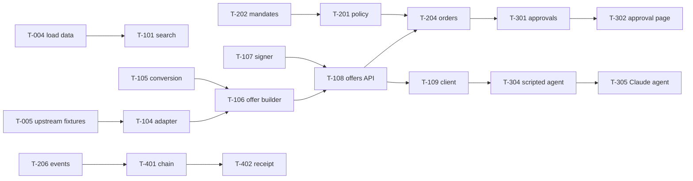

# 08. Implementation plan

Six build phases and a demo-prep phase. Each phase ends in something that runs. The acceptance scenario works end to end after phase 3.

## 0. Deadline, scope and schedule (revised 2026-11-14)

This section overrides the hours and the cut order below where they disagree.

**Deadline.** Everything is submitted by **Sunday 15 November 2026, 10:00 Europe/Helsinki**. Feature freeze is **Sunday 00:00**.

**Cut now:** T-501 (ranked options), T-502 (MCP server), T-503 (rules R7 and R10), T-504 (rate limiting). These are cuts 1 to 3 of section 6, applied deliberately. No replay mode.

**Priority order:**

1. Phase 1 (lookup and offers)
2. Phase 2 (mandate and orders)
3. Phase 3 (approval and agent)
4. From phase 4, only T-401 (event log with hash chain), T-402 (receipt), T-403 (receipt page) and T-405 (`allergy_guard`)
5. T-404 (split with gateway substitutes) and T-406 (comparison fields) only if everything above is done by **Saturday 20:00**

**Targets (Saturday 14 November):**

| Milestone | Target |
|---|---|
| Phases 1 and 2 "Done when" | 12:00 |
| Phase 3 "Done when" | 18:00 |
| Phase 4 subset (T-401, T-402, T-403, T-405) | 20:00 |
| Optional T-404, T-406 | before 24:00 freeze |
| Feature freeze | Sunday 00:00 |
| Phase 6 demo preparation and submission | Sunday 00:00 to 10:00 |

Any phase running more than an hour behind its target is reported at once. Phase 5's remaining tasks (T-505 anonymous demo step, T-506 OpenAPI tidy-up) are done during phase 6 if time allows.

**Hosting.** Development and tests run against a local MariaDB in Docker. Deployment to Modal waits for a hosted database (Q-01); nothing in phases 1 to 3 depends on it.

**Ways of working.** Each phase is built by parallel sub-agents on tasks that are independent in section 4, never two on the same file, against the shared contracts in `handshake/models.py` and `handshake/errors.py`.

Hours assume about 30 working hours and a team of three or four (A-15). Scale them to the real deadline.

## 1. Roles

| Role | Owns |
|---|---|
| BE-A | Schema, loader, catalog, upstream adapter, offer builder, signing |
| BE-B | Policy engine, orders, approvals, holds, events, receipts |
| AG | Client library, Claude agent, scripted agent, MCP server, code lookup, fixtures |
| FE | Approval page, receipt page, console, slides, video, submission text |

With three people, merge AG and FE and drop the MCP server first.

## 2. First hour: shared contracts

Before anyone writes feature code, the team agrees and commits:

1. The Pydantic models in `handshake/models.py` for Offer, OfferLine, Mandate, Reason, Evaluation and Order, copied from documents 03 and 05.
2. The error format and codes (document 03, section 1.2).
3. One recorded upstream price response and one availability response as fixtures (this also answers Q-02, Q-04 and Q-05).

Everything else can then be built in parallel against these.

## 3. Phases

### Phase 0: setup (2 h)

| Task | Owner | Requirement |
|---|---|---|
| T-001 Repository, layout from document 02, `.gitignore` for `data/` and secrets | BE-A | NFR-08 |
| T-002 MariaDB instance reachable from Modal; run `sql/schema.sql` | BE-A | Q-01 |
| T-003 Modal app with `GET /v1/health`; secret `handshake` | BE-A | |
| T-004 `scripts/load_data.py`; verify row counts | BE-A | |
| T-005 Call `/api/ping`, `/api/price`, `/api/availability` for the demo shortlist; save fixtures; record answers to Q-02 to Q-05 | AG | |
| T-006 `scripts/gen_keys.py`; key in the secret | BE-B | |
| T-007 `code_lookup` seed | AG | A-06 |

Done when: a public URL returns health OK, the database holds 17,546 products, and the team knows live prices and stock for the eight shortlist products.

### Phase 1: lookup and offers (5 h)

| Task | Owner | Requirement |
|---|---|---|
| T-101 `GET /v1/products` with all filters and paging | BE-A | FR-01, FR-02, FR-04 |
| T-102 `GET /v1/products/{product_id}` with untrusted text separated | BE-A | FR-03, FR-04 |
| T-103 Agent authentication; anonymous access rules | BE-B | FR-05 |
| T-104 Upstream adapter with cache, snapshots, error mapping | BE-A | NFR-01, NFR-03 |
| T-105 Quantity conversion | BE-A | FR-12 |
| T-106 Offer builder P0: candidates, filters, fill in preference order, holds | BE-A | FR-10, FR-13, FR-14, FR-18 |
| T-107 Signer; `/.well-known/jwks.json`; `/.well-known/handshake.json` | BE-B | FR-11, FR-70 |
| T-108 `POST /v1/offers`, `GET /v1/offers/{offer_id}` | BE-A | FR-10, FR-11 |
| T-109 `agent/handshake_client.py` and `agent/verify_offer.py` | AG | |

Done when: a curl call returns a signed offer for 1,000 L, `verify_offer.py` accepts it, and a tampered copy is rejected.

### Phase 2: mandate and orders (5 h)

| Task | Owner | Requirement |
|---|---|---|
| T-201 Policy engine with rules R1 to R6, R8, R9 as a pure function, with unit tests | BE-B | FR-31, FR-32, FR-37, NFR-04 |
| T-202 Mandate storage; `PUT` and `GET /v1/admin/agents/{agent_id}/mandate`; `GET /v1/mandates/current` | BE-B | FR-30, FR-38 |
| T-203 `POST /v1/orders/dry-run` | BE-B | FR-33 |
| T-204 `POST /v1/orders` with offer locking, idempotency, three outcomes, hold transitions | BE-B | FR-15, FR-16, FR-17, FR-31 |
| T-205 `GET /v1/orders/{order_id}` | BE-B | FR-36 |
| T-206 Event writer (plain append; chaining comes in phase 4) called from every step | BE-B | FR-60 |
| T-207 `scripts/seed_demo.py`: customers, agents, mandates from document 09 | AG | |

Done when: the same offer returns `accepted` with a high cap and `needs_approval` with a low cap, and repeating the order request returns the same order.

### Phase 3: approval and agent (5 h)

| Task | Owner | Requirement |
|---|---|---|
| T-301 Approval creation, token, expiry | BE-B | FR-34, FR-35 |
| T-302 Approval page `GET` and `POST /approve/{token}`, mobile layout | FE | FR-34 |
| T-303 `GET /v1/admin/orders/{order_id}/approval-link`; console page with event list and QR | FE | A-09 |
| T-304 Scripted agent, scenario `milk_order` | AG | |
| T-305 Claude buyer agent with the eight tools | AG | |
| T-306 `scripts/reset_demo.py` and `POST /v1/admin/reset` | BE-B | NFR-07 |

Done when: the example request runs from one prompt to a confirmed order, with approval on a phone. Record a video now.

### Phase 4: receipt and exceptions (5 h)

| Task | Owner | Requirement |
|---|---|---|
| T-401 Hash chaining in the event writer; chain verification helper (kept; see section 0) | BE-B | FR-61 |
| T-402 `GET /v1/orders/{order_id}/receipt` with signed receipt | BE-B | FR-62 |
| T-403 Receipt page, buyer and Valio Aimo views | FE | FR-62 |
| T-404 Split across alternates and substitutes; `differences`; official substitution rules (only if time allows; section 0) | BE-A | FR-19, FR-50, FR-51 |
| T-405 Scripted agent scenario `allergy_guard`; second seeded agent | AG | FR-37 |
| T-406 Comparison fields on offer lines and in search (only if time allows; section 0) | BE-A | FR-06, FR-40 |

Done when: a split offer shows roles and differences, the milk-allergy order is rejected with the correct reason, and the receipt timeline renders.

### Phase 5: polish and proof (4 h)

| Task | Owner | Requirement |
|---|---|---|
| ~~T-501 Ranking and up to three options with score breakdown~~ (cut) | BE-A | FR-20, FR-41 |
| ~~T-502 MCP server~~ (cut) | AG | FR-72 |
| ~~T-503 Rules R7 and R10~~ (cut) | BE-B | |
| ~~T-504 Rate limiting~~ (cut) | BE-B | NFR-02 |
| T-505 Anonymous-versus-authenticated demo step | AG | FR-05 |
| T-506 OpenAPI descriptions and examples tidy-up | BE-A | FR-71 |

Done when: a second client orders through MCP, or the cut list below has been applied deliberately.

### Phase 6: demo preparation (4 h)

| Task | Owner |
|---|---|
| T-601 Freeze code; tag the release; final deploy | BE-A |
| T-602 Three clean run-throughs in a row with reset between each | All |
| T-603 Final backup video | FE |
| T-604 Slides and submission text; mention MariaDB and Modal | FE |
| T-605 Prepare answers to the judge questions in document 09 | All |

## 4. Dependencies

BE-B can build T-201 and T-202 against the shared models before any offer exists, using hand-written offer fixtures.

## 5. Definition of done (every task)

- Behaviour matches documents 03 to 06; any deviation is written back into the document in the same commit.
- Unit or API test added where document 09 lists one.
- No secret, key or challenge data in the commit.
- Deployed to Modal and exercised once against the real database.

## 6. Cut order

If time runs short, cut in this order. Each cut removes the listed tasks and nothing else breaks. Cuts 1 to 3 were applied on 2026-11-14 (section 0); cuts 4 and 6 apply automatically if T-404 and T-406 are not done by Saturday 20:00.

| Cut | Tasks | Effect on the demo |
|---|---|---|
| 1 | T-501 | One option only; no score breakdown |
| 2 | T-502 | MCP shown on a slide |
| 3 | T-503, T-504 | State the order-splitting limitation if asked |
| 4 | T-406 | No reliability or carbon in offers |
| 5 | T-401 | Plain event log; receipt has no chain |
| 6 | T-404 | No split; choose a product and quantity that one product can fill |
| 7 | T-403 | Receipt shown as JSON |

Never cut: signed offers (T-106 to T-108), the three outcomes (T-201, T-204), the approval page (T-301, T-302), and the scripted agent (T-304).

## 7. Working agreements

- Keep Claude out of the rule path. The agent decides what to ask for; the gateway decides what is allowed.
- Use a cheaper model during development and save credits for rehearsal and the demo.
- Run `reset_demo.py` before every rehearsal.
- When a question in document 10 is answered, update document 10 first, then the sections it lists.
